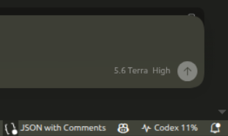
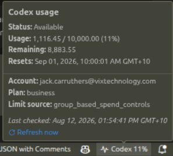

# Codex Usage

Displays Codex usage and spend-limit information in the VS Code status bar.

The extension reads the same local credentials as the Codex CLI from
`~/.codex/auth.json` and requests usage directly from the ChatGPT usage API.
Credentials remain in the local VS Code extension host and are never logged.

## At a Glance

The status bar shows the current percentage of the applicable Codex spend limit.



Hover over the status-bar item to see the usage, remaining allowance, reset time,
account, plan, and a refresh link.



## Features

- Compact current usage percentage in the status bar.
- Warning state when a rate limit or spend limit has been reached.
- Hover details for usage, remaining allowance, reset time, account, and plan.
- Click-to-refresh status bar item and `Codex Usage: Refresh` command.
- Automatic refresh every five minutes by default.

## Development

```sh
npm install
npm run compile
```

Open this directory in VS Code and press `F5` to launch an Extension Development
Host. To install it normally, package it as a VSIX and install that VSIX in VS Code.

## Settings

- `codexUsage.accountDirectory`: directory containing Codex auth files.
- `codexUsage.accountName`: optional named account, loaded as `<name>.auth.json`.
- `codexUsage.dateLocale`: optional date locale such as `en-AU`; defaults to the
  VS Code display language.
- `codexUsage.refreshIntervalMinutes`: automatic refresh interval; `0` disables it.
- `codexUsage.requestTimeoutSeconds`: API request timeout.
